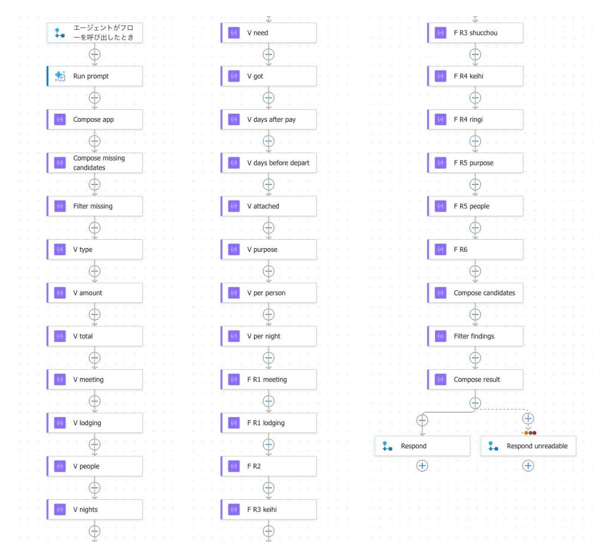

# shinsei-check

申請書（PDF・写真）をチャットに添付すると、社内規程と照らして不備を返す Copilot Studio エージェントを、2 通りの構成で作ったときのコード一式です。会社名・規程・申請書はすべて架空のものです。

| 構成 | 判断するもの | 作るもの |
|---|---|---|
| A: LLM にそのまま読ませる | エージェント（LLM） | 指示文（`copilot-studio/instructions-a.md`）と規程の PDF |
| B: AI Builder とフローで判定する | Power Automate のフローの式 | 抽出プロンプト（`prompts/`）、フロー（`flows/`）、指示文（`copilot-studio/instructions.md`） |

## フロー（構成 B）



1. `Run prompt`: AI Builder のプロンプトが申請書から値を抜き出し、JSON で返す
2. `Compose missing candidates`〜`Filter missing`: 判定に欠かせない値（申請種別・申請金額・明細・申請日など）を読めたかを確かめる
3. `V …`: 明細の合計、1 人あたりの会議費、必要な決裁者などを計算する
4. `F …`: ルールごとに、違反していれば条番号と理由の文を組み立てる
5. `Compose result`〜`Respond`: 読めなかった項目があれば `unreadable`、なければ `checked` と指摘の一覧を返す

フローは手で組まず、`rules/rules.json` のしきい値と条番号から `flows/build.py` が定義を生成します。生成した定義は `flows/out/*.clientdata.json` にあります（環境の ID は入っていません）。

| 画面 | ファイル |
|---|---|
| AI Builder の呼び出し | `docs/screens/flow-run-prompt.png` |
| 決裁者のルールの式 | `docs/screens/flow-rule-r2-code.png` |
| 結果の組み立て | `docs/screens/flow-compose-result.png` |
| 構成 B のエージェントと応答 | `docs/screens/agent-b-overview.png`・`agent-b-chat-checked.png`・`agent-b-chat-unreadable.png` |
| 構成 A のエージェントと応答 | `docs/screens/agent-a-overview.png`・`agent-a-chat.png` |

## 中身

| 場所 | 内容 |
|---|---|
| `kitei/`・`kitei/v2/` | 架空の規程 3 本（Markdown と PDF）。v2 は表引きやただし書きを足した版 |
| `rules/` | しきい値と条番号の定義。フローの式と判定エンジンの両方がここから読む |
| `src/shinsei/rules.py` | 判定エンジン。フローと同じ条件を Python で書いたもので、正解を出すのに使う |
| `src/shinsei/generate*.py` | サンプルの申請書を作る（macOS のフォントを使う） |
| `samples/` | サンプルの申請書 40 件と、期待される指摘 |
| `flows/` | フロー定義の生成と、Dataverse への作成 |
| `scripts/` | フローに申請書を流して、期待される指摘と比べる |
| `docs/` | ドメインの仕様、画面の写し |

## 動かし方

テストは環境なしで動きます。

```
uv sync
.venv/bin/python -m pytest -q
```

自分の環境にフローを作るときは、次の順に進めます。

1. AI Builder でプロンプトを作る。入力は「画像またはドキュメント」、出力は JSON、文面は `prompts/extract.ja.md`（v2 は `prompts/extract.v2.ja.md`）
2. `config.example.json` を `config.local.json` にコピーし、自分の環境の値を入れる（このファイルは Git に入りません）
3. `az login` のあと `.venv/bin/python flows/build.py` を実行する。フロー「Shinsei Check」（エージェント用）と「Shinsei Check HTTP」（答え合わせ用）ができる
4. Copilot Studio でエージェントを作り、フロー「Shinsei Check」をツールに登録して、`copilot-studio/instructions.md` を指示に入れる
5. `.venv/bin/python scripts/eval_flow.py` で、サンプル 20 件の結果を期待される指摘と比べる

## 注意

- AI Builder のプロンプトの実行は、AI Builder クレジットまたは Copilot クレジットを消費します
- 申請書を読む部分は AI なので、同じファイルでも読み取りが変わることがあります
- 「Shinsei Check HTTP」は答え合わせ用で、呼び出し用の URL を知っていれば誰でも実行できる設定です。URL は公開せず、使い終わったらフローをオフにしてください
- サンプルの人名・会社名は架空のもので、実在の人物・団体とは関係ありません
- 手書き風のサンプルはフォントで作ったもので、実際の手書きではありません

## ライセンス

MIT License（`LICENSE`）
